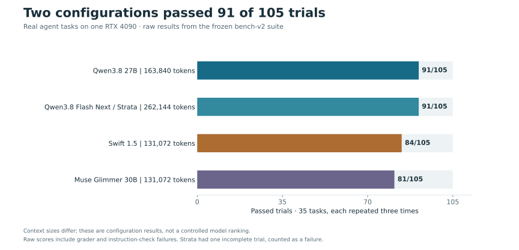
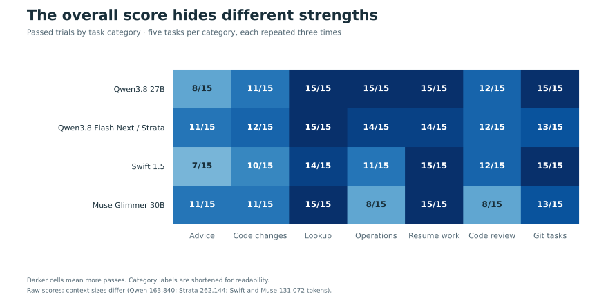
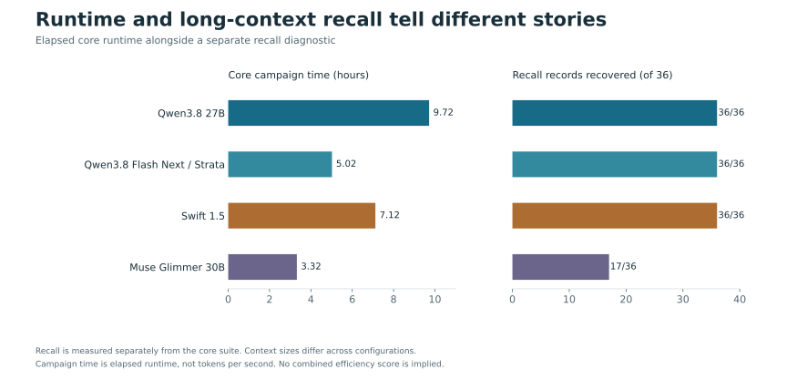

# Finding a local model I could work with

Which local models can handle real agent work on a single 24 GB RTX 4090, and what does fitting them into memory cost in quality and speed?

I built this project around tasks drawn from my own agent work: making code changes, finding information, reviewing code, handling operations, resuming interrupted work, and working with Git. The tests cover task completion as well as recall over long contexts and basic tool use.

## What I learned

Qwen3.8 and Strata each passed 91 of 105 core trials, but differed by task category. Muse finished its core campaign fastest, while recovering only 17 of 36 records in the separate long-context recall diagnostic. The other three configurations recovered all 36.

Memory settings mattered too. The published Qwen3.8 profile keeps a q8 KV cache and disables speculative decoding. Separate fitting experiments decoded faster with another configuration, but keeping the higher-precision cache and required memory headroom meant giving up that speed.

These are results for complete configurations on this machine. Context sizes differ, so the totals do not establish a controlled model ranking. All four use the same frozen core tasks and grader. Raw counts include instruction-check and grader failures; the detailed results explain reviewed adjustments.

## How I narrowed the field

The work started with a recall runner, then expanded into 35 tasks drawn from real work and a plan to screen configurations before running fuller comparisons. Context fit, memory headroom, request settings and grading all needed attention before the scores were useful.

The published development history records these earlier steps:

| Configuration or experiment | What the record shows |
|---|---|
| Occamy 1.0 | A requested 262K run silently fell back to 98,304 tokens. The runner was fixed to include each preset's configured context as a fitting step. This was a runner defect, not evidence of model quality. |
| Gemma 4 31B IT | Removed from the October 31 plan. The published history does not give the reason or test scores. |
| Qwen3.8 UD-IQ4_XS at 262K | Added to the October 31 plan. Its outcome is not included in this public export. |
| Strata | Earlier engine work was archived; testing restarted on 0.1.54 with 131K and 262K context configurations. |
| Qwen3.8 27B | A fitting sweep led to the accepted 163,840-token configuration used in the final core comparison. |

The original testing records remain private. This public export currently contains aggregate results for the four configurations below; it does not contain the complete earlier screening results. The table above preserves what the [development timeline](docs/devlog/2026-10-02-to-10-31-timeline.md) establishes without assigning missing scores or reasons for exclusion.

## Where the configurations differed

Each category contains five tasks, repeated three times. The chart uses plain-language labels: "resume work" means picking up interrupted work, and "Git tasks" covers the suite's surgery category.

Campaign time is elapsed runtime for the core suite. Recall comes from a separate diagnostic, so the two measurements are shown alongside each other rather than combined into an efficiency score.

## Checking the benchmark itself

A one-line grader bug rejected eight correct document answers. Other reviews found contradictory task instructions and an inverted matcher. Fixes affected 22 of the 35 core tasks, so I froze a replacement suite, bench-v2, for subsequent comparisons.

Those findings changed how I read failed trials. A failure needed investigation before I could attribute it to the model. The results below retain raw scores and distinguish confirmed corrections from disputed cases.

## My contribution

I set the goals, rules, acceptance checks and stop conditions, reviewed results, and made the final calls. Claude, Codex and DeepSeek wrote almost all of the code. pi is the agent framework used in the published evaluation.

The engineering work includes recoverable unattended runs, isolated task execution, memory-fit checks, and reviews of disputed scores. The [development log](docs/devlog/index.md) explains how those pieces evolved; [benchmark decisions](DECISIONS.md) records the rules behind the results.

## Detailed results

[Download the aggregate results](results/bench-v2.json), including campaign dates, category counts, adjustment rules and measurement limitations. Raw trial records remain private.

The core comparison uses 35 tasks drawn from real agent work, five in each of seven categories, run three times each. Every core row below uses the same frozen task set and grader (`bench-v2`, grader `04468edc`).

| Model and profile | Engine, context | Core raw | Core adjusted | Wall time |
|---|---|---:|---:|---:|
| Qwen3.8 27B, Unsloth Q4_K_M (`qwen3.8-27b-unsloth-q4-mtp`) | llama.cpp, 163,840 | 91/105 | 98/105 (101 upper bound) | 9.7 h |
| Qwen3.8 Flash Next IQ3_S (`strata-iq3s`) | Strata 0.1.54, 262,144 | 91/105 (1 incomplete) | n/a | 5.0 h |
| Swift 1.5, Qwen3.8 27B fine-tune (`swift-qwen3.8-27b-vision`) | llama.cpp, 131,072 | 84/105 | n/a | 7.1 h |
| Muse Glimmer 30B (`muse-glimmer-30b`) | llama.cpp, 131,072 | 81/105 | n/a | 3.3 h |

The contexts differ, so these totals are not a head-to-head ranking. Adjusted scores count confirmed style or grader faults as passes, preserving the 105-trial denominator; only Qwen3.8 has a reviewed adjusted score so far. Its 101 upper bound also counts three disputed haystack trials as passes, one of which contains a possible model error, so 98 is the reported adjusted result.

Category counts, diagnostics and additional accuracy suites

### Core score by category

Each cell is passed trials out of 15. Raw counts include style and task/grader issues. The haystack task and one inverted matcher need follow-up, so read the totals with the caveats above.

| Category | Qwen3.8 163K | Strata 262K | Swift 131K | Muse 131K |
|---|---:|---:|---:|---:|
| Advisory | 8/15 | 11/15 | 7/15 | 11/15 |
| Implementation | 11/15 | 12/15 | 10/15 | 11/15 |
| Lookup | 15/15 | 15/15 | 14/15 | 15/15 |
| Operations | 15/15 | 14/15 | 11/15 | 8/15 |
| Resume | 15/15 | 14/15 | 15/15 | 15/15 |
| Review | 12/15 | 12/15 | 12/15 | 8/15 |
| Surgery | 15/15 | 13/15 | 15/15 | 13/15 |

### Diagnostics

Three repeated recall prompts probe long-context retrieval; ten tool calls check basic tool-loop reliability; five chat tasks are repeated three times.

| Model and context | Recall | Tool calls | Chat sweep |
|---|---:|---:|---:|
| Qwen3.8, 163K | 3/3 (36/36 records) | 10/10 | 15/15 |
| Strata, 262K | 3/3 (36/36 records) | 10/10 | 12/15 |
| Swift, 131K | 3/3 (36/36 records) | 10/10 | 15/15 |
| Muse, 131K | 0/3 (17/36 records) | 10/10 | 15/15 |

Muse's recall miss near 112K tokens repeats earlier diagnostics. Qwen3.8 decoded at about 45 tokens/s in the core campaign (40.3 tokens/s in the fitting sweep) with MTP off and a q8_0 KV cache. MTP reached 78 tokens/s in a separate sweep with q4_0 KV cache, while a separate MTP/q8_0 sweep at 131,072 context and ubatch 512 missed the 1,024 MiB free-memory floor. The published profile therefore keeps q8_0 and disables MTP: the memory fit costs decode speed.

### Additional accuracy suites

These are broader task suites, reported as passed/total. They were run in separate campaigns, not as part of the three-run core comparison. A dash means the suite was not run for that profile. Depth and documents below use the post-fix rescoring reported in the private chain report (2026-11-07, section 7).

| Model | Depth | Documents | Mined fixes | Game tasks | Vision |
|---|---:|---:|---:|---:|---:|
| Qwen3.8, 163K | 5/5 | 6/6 | 18/20 | 6/6 | Not run |
| Strata, 262K | 5/5 | 6/6 | 18/20 | 6/6 | Not run |
| Swift, 131K | 5/5 | 6/6 | 16/20 | 4/6 | 10/10 |
| Muse, 131K | 4/5 | 4/6 | 16/20 | 5/6 | 9/10 |

The original depth counts were Qwen3.8 3/5, Swift 3/5, Strata 4/5 and Muse 3/5 (three passes out of four measured). Qwen3.8 and Swift documents were originally 3/6. The saved runs were rescored after the one-line decoy grader, missing-model-path environment fault and depth-floor fixes. Muse's two document misses remain genuine. These figures are transcribed from the private 2026-11-07 chain report, section 7; they were not independently rescored for this publication. The core grader hash above applies to core results only. Strata's mined/game campaigns date to 2026-11-04 on an older harness; task identity across those campaigns has not been established here.

At the common 131,072 context, separate 2026-11-07 diagnostics recorded Qwen3.8 recall 3/3, tools 10/10 and chat 5/5; Strata recorded 3/3, 10/10 and 4/5. Post-fix accuracy was Qwen3.8 depth 5/5 and documents 6/6, versus Strata depth 4/4 measured and documents 6/6, with one Strata depth task unmeasured. These single campaigns are historical diagnostics, not three-repeat core comparisons.

## Development and evaluation method

The harness was built with Claude, Codex and DeepSeek. pi is the agent framework under test. Plans define scope, acceptance checks and stop conditions; code changes are reviewed before runs, and final acceptance remains human-reviewed. [DECISIONS.md](DECISIONS.md) records the rules and their rationale. The [development log](docs/devlog/) tracks the milestones and resulting changes.

| Area | Method |
|---|---|
| Independent review | Review rounds preceded live-adapter use. The unattended runner also passed signal drills. |
| Live-run safety | Runs require an acceptance step and approval token. The runner restores the production model server on completion or failure. |
| Recovery | Runs checkpoint state atomically, append events to an fsynced log, and can resume after interruption. |
| Score integrity | Full answers are reviewed when a result is disputed. An audit found six core tasks that failed on every model; two were confirmed test flaws and later fixed. The available review records do not identify the other four, so this summary does not classify them. A one-line grader bug rejected eight correct document answers. |
| Comparability | Fixes changed 22 of 35 core tasks, so `bench-v2` froze the task set and grader. Earlier scores remain historical records, not a baseline. |
| Operator scope | An operator agent may restart the model server and commit operational fixes separately. It cannot change tasks, graders, verdicts or limits during a run queue. |
| Sampling | Each model uses its publisher's defaults. Samplers without a published recommendation are disabled instead of inheriting llama.cpp defaults. |

## What it measures

- Core: 35 tasks in seven categories drawn from real agent work logs; 24 use this benchmark repository’s own snapshots. Each task is verified to fail when the agent does nothing and pass when the known solution is replayed.
- Diagnostics: context-sized recall, ten tool calls and repeated synthetic chat sweeps.
- Accuracy suites: depth tasks near the harness compaction point, long-document questions, 20 fixes mined from other repos, six game tasks and ten vision tasks.
- Recorded fit settings (not a controlled quality comparison): KV-cache precision, ubatch size, CPU offload of MoE layers, speculative decoding and context from 131,072 to 262,144 tokens.

A core trial passes when its task-specific grader and applicable frozen instruction checks pass. Style-only failures include the no-em-dash rule in [the frozen agent instructions](configs/pi-agents-md-bench.md). Of 35 core tasks, 24 use snapshots of this benchmark repository across implementation, lookup, resume, review and advisory, limiting coverage of outside projects. Published harness code matches private bench-v2 `c19f776`; comments may cite private plans. The aggregate counts do not use the historical scoring module.

The memory-fit threshold is 1,024 MiB of free GPU memory beside a working desktop. The agent runs in a bubblewrap sandbox with a private network. Its only exits are the model server and a canned-page proxy. llama.cpp is pinned at build 12017, and each run records its harness commit, grader hash and mode.

## Status and limits

- Four profiles have completed the core comparison. The suite audit is next; the haystack task contradicts its own packet, and one matcher is inverted.
- The core suite is small. Three repeats help reveal variability, but 35 tasks cannot represent every kind of agent work.
- This repo is for reading. Running it requires the original machine's model server, presets and run data, which are not included. Mined and game tasks also depend on source repos that are not included.
- The public repo excludes the private development history. Commit IDs in the documents refer to the private development repo. Run folders, transcripts and operator logs stay private.

The harness lives in `llm_eval/`; `fixtures/` holds test tasks, and `suites/` and `configs/` hold run definitions. The checkout is the runnable unit: fixtures, configs and suites are loaded relative to the repository, and are not bundled in a wheel.

## Credits and license

The benchmark drives tools it does not include: llama.cpp, Strata, pi and opencode. The models belong to their publishers, linked from their pages in [`models/`](models/). The code and docs are MIT licensed; see [LICENSE](LICENSE).
