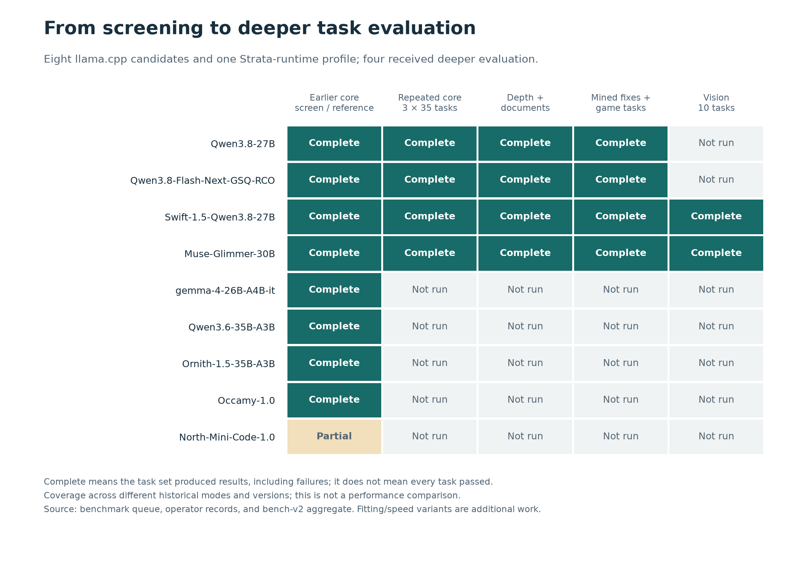
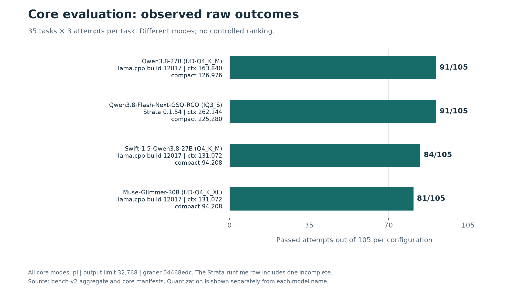
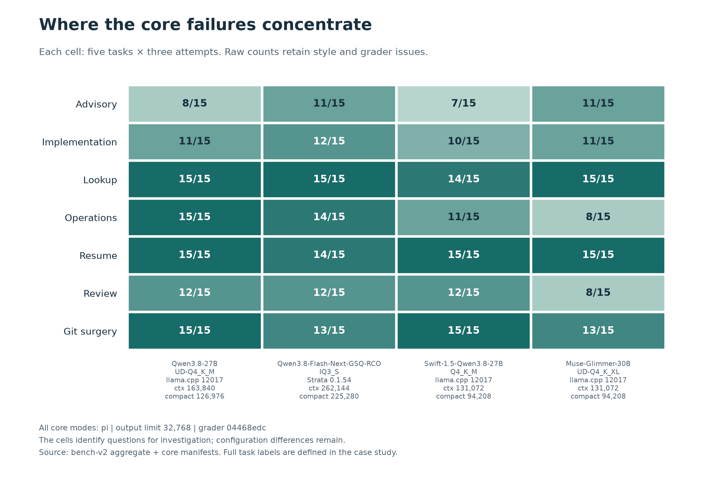
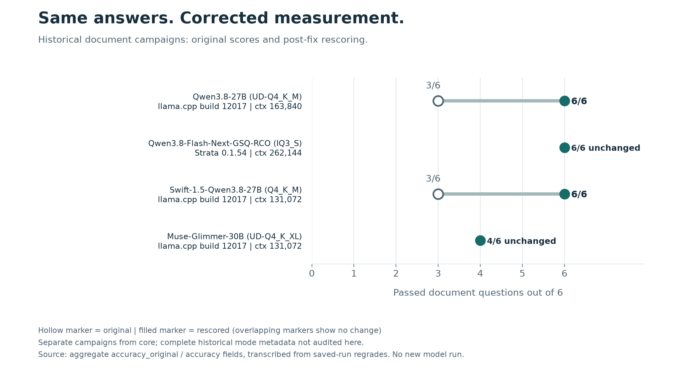
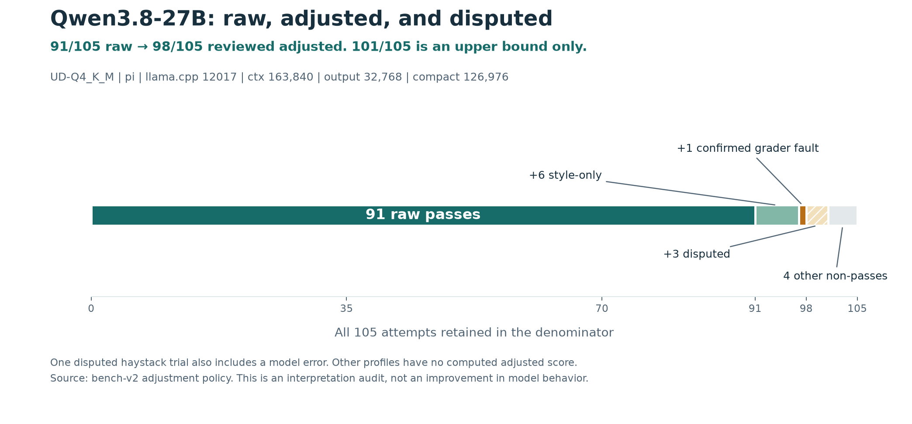

# Choosing a local AI model

I kept switching between local models, trying to decide which to use for a particular problem. I built llm-eval to make that choice repeatable, using repository edits, information retrieval, operational diagnosis, reviews, and unfinished work from my own projects.

The work covered eight llama.cpp candidates and Qwen3.8-Flash-Next-GSQ-RCO on the Strata runtime, plus configuration and speed tests. Four profiles progressed to deeper evaluation, including 35 core tasks attempted three times each. Everything ran on my desktop with one 24 GB RTX 4090.

Qwen3.8-27B is now my daily driver. Qwen3.8-Flash-Next-GSQ-RCO remains a candidate for another pass with revised tests and updated code. The project gives me a benchmark I can reuse for future models.

[Benchmark reference](docs/benchmark-reference.md) · [Four-profile aggregate data](results/bench-v2.json) · [Chart data](docs/charts/case-study-data.json)

## My role

AI agents wrote almost all the code. I set the goals, operating constraints, acceptance checks, and stop conditions; requested investigations; challenged proposed approaches; and made the final calls. Agents implemented the harness and performed detailed diagnoses. I commissioned reviews using other models and requested runtime estimates before committing to longer runs.

The development record shows how that worked: questioning inconsistent model settings, asking whether failures belonged to the model or the test, and challenging memory trade-offs before approving configuration changes.

## What I tested

The core suite has five tasks in each of seven categories: advisory, implementation, lookup, operations, resume, review, and Git surgery. Additional suites cover long-context recall, documents, basic tool calls, fixes mined from other repositories, game-development tasks, and vision.

Agents checked core graders against a no-op and a known solution. They tested mined-fix solutions repeatedly and replaced a flaky task. Adversarial reviews attempted shortcuts, including skipping tests while retaining a successful exit code. The fixes added skipped-test checks, stronger protection of original tests, and pinned task environments.

The harness retains full answers, model requests, tool activity, workspace end states, server logs, and system measurements for investigating disputed results.

## Broad screening and configuration work

The selected llama.cpp screens below used pi, llama.cpp build 12017, and a configured output limit of 32,768 tokens. The two score columns preserve the original record and the November 6 rescoring. Each screen covered 35 tasks; context and compaction thresholds differed.

| Exact model name | Quantization | Context / compaction | Recorded | Nov. 6 rescored |
|---|---|---:|---:|---:|
| Qwen3.8-27B | UD-Q4_K_M | 163,840 / 126,976 | 24/35 | 25/35 |
| Swift-1.5-Qwen3.8-27B | Q4_K_M | 131,072 / 94,208 | 23/35 | 26/35 |
| Muse-Glimmer-30B | UD-Q4_K_XL | 131,072 / 94,208 | 23/35 | 28/35 |
| gemma-4-26B-A4B-it | Q4_K_L | 196,608 / 159,744 | 17/35 | 20/35 |
| Qwen3.6-35B-A3B | UD-Q4_K_XL | 262,144 / 225,280 | 14/35 | 14/35 |
| Ornith-1.5-35B-A3B | Q4_K_M | 196,608 / 159,744 | 13/35 | 14/35 |
| Occamy-1.0 | Q4_K_M | 196,608 / 159,744 | 12/35 | 12/35 |
| North-Mini-Code-1.0 | UD-Q4_K_XL | 196,608 / 159,744 | Incomplete | Incomplete |

These are historical screens. A later path-grader fix moved Qwen3.6-35B-A3B to 15/35. Ornith-1.5-35B-A3B and Occamy-1.0 need fresh screens because the old harness reply invited action on question-only tasks. North-Mini-Code-1.0 never produced a complete core score: review found malformed output, a parser issue, and a self-inflicted hang after it replaced a server executable with a sleeping script. Incomplete coverage is not a score of zero.

The initial plan screened broadly before deeper testing. Qwen3.8-27B, Muse-Glimmer-30B, and Swift-1.5-Qwen3.8-27B progressed from these screens, joining Qwen3.8-Flash-Next-GSQ-RCO. I chose full suites for all four. Later fixes changed 22 of the 35 task identities, so the repeated core evaluation used a frozen task set and grader. [Screening review](https://github.com/scmalone/llm-eval/blob/main/docs/devlog/2026-11-06-full-review-and-fixes.md)

Configuration sweeps separately measured context, cache precision, batch sizes, speculative decoding, and CPU offload. Alternate Qwen3.8-27B quantizations and Muse-Glimmer-30B draft/no-draft presets were not automatically given full accuracy runs. Earlier gemma-4-31B-it configuration checks ended in its exclusion from the accuracy roster: it could load only 65,536 context tokens, below the 131,072 minimum.

A three-run Qwen3.6-35B-A3B speed check recorded 87.6, 87.4, and 87.8 decode tokens per second, a 0.46% spread against a 3% adoption threshold. Separate probes found that one extra CPU MoE layer let Occamy-1.0, Ornith-1.5-35B-A3B, and North-Mini-Code-1.0 retain 262,144 context tokens while meeting the free-memory floor; gemma-4-26B-A4B-it needed two. These were fitting and timing measurements, not quality improvements.

## Repeated core results

| Exact model name | Quantization | Runtime | Context / compaction | Raw core |
|---|---|---|---:|---:|
| Qwen3.8-27B | UD-Q4_K_M | llama.cpp 12017 | 163,840 / 126,976 | 91/105 |
| Qwen3.8-Flash-Next-GSQ-RCO | IQ3_S | Strata 0.1.54 | 262,144 / 225,280 | 91/105 |
| Swift-1.5-Qwen3.8-27B | Q4_K_M | llama.cpp 12017 | 131,072 / 94,208 | 84/105 |
| Muse-Glimmer-30B | UD-Q4_K_XL | llama.cpp 12017 | 131,072 / 94,208 | 81/105 |

All four modes use pi, a 32,768-token output limit, and the frozen bench-v2 core grader. Qwen3.8-Flash-Next-GSQ-RCO includes one incomplete attempt within its 105-trial denominator. Modes differ, so these counts do not establish a controlled model ranking.

Context is the material available within a session; compaction summarizes earlier material to make room. Thresholds are configured settings, not a claim that each task reached them. Exact profile entries and measured modes accompany the chart data.

| Category | Qwen3.8-27B, 163,840 | Qwen3.8-Flash-Next-GSQ-RCO, 262,144 | Swift-1.5-Qwen3.8-27B, 131,072 | Muse-Glimmer-30B, 131,072 |
|---|---:|---:|---:|---:|
| Advisory | 8/15 | 11/15 | 7/15 | 11/15 |
| Implementation | 11/15 | 12/15 | 10/15 | 11/15 |
| Lookup | 15/15 | 15/15 | 14/15 | 15/15 |
| Operations | 15/15 | 14/15 | 11/15 | 8/15 |
| Resume | 15/15 | 14/15 | 15/15 | 15/15 |
| Review | 12/15 | 12/15 | 12/15 | 8/15 |
| Git surgery | 15/15 | 13/15 | 15/15 | 13/15 |

Categories identify where failures concentrate. Raw counts include style and grader issues, which need investigation before a capability claim. In diagnostics, Muse-Glimmer-30B retrieved 17 of 36 recall records; the other profiles retrieved all 36. All four passed ten basic tool-call checks, which used short prompts and did not test tool use at depth.

The additional accuracy suites produced these outcomes:

| Exact model name and context | Depth | Documents | Mined fixes | Game | Vision |
|---|---:|---:|---:|---:|---:|
| Qwen3.8-27B, 163,840 | 5/5 | 6/6 | 18/20 | 6/6 | Not run |
| Qwen3.8-Flash-Next-GSQ-RCO, 262,144 | 5/5 | 6/6 | 18/20 | 6/6 | Not run |
| Swift-1.5-Qwen3.8-27B, 131,072 | 5/5 | 6/6 | 16/20 | 4/6 | 10/10 |
| Muse-Glimmer-30B, 131,072 | 4/5 | 4/6 | 16/20 | 5/6 | 9/10 |

These are separate historical campaigns. Depth and document counts include saved-run rescoring. The Qwen3.8-Flash-Next-GSQ-RCO mined/game runs used an older harness; matching task identities across campaigns has not been established. These suites are not pooled into the core score.

## Testing whether the scores deserved trust

When Qwen3.6-35B-A3B screened poorly, I questioned whether coding-specific settings were being compared with thinking settings. Captured requests confirmed the mismatch. I requested vendor research and pushed back on building more harness machinery before using available recommendations. The policy then used publisher general-thinking settings, with exceptions recorded. [Settings investigation](https://github.com/scmalone/llm-eval/blob/main/docs/devlog/2026-11-04-like-for-like-settings.md)

I requested an investigation into whether failures belonged to the models or the tests. Agents inspected full answers and end states. A document grader was rejecting correct answers that named a distractor to explain its rejection; answer layout affected the verdict.

| Historical document campaign | Original | Rescored |
|---|---:|---:|
| Qwen3.8-27B, context 163,840 | 3/6 | 6/6 |
| Qwen3.8-Flash-Next-GSQ-RCO, context 262,144 | 6/6 | 6/6 |
| Swift-1.5-Qwen3.8-27B, context 131,072 | 3/6 | 6/6 |
| Muse-Glimmer-30B, context 131,072 | 4/6 | 4/6 |

The same saved answers produced different scores after the correction. That removed the apparent document-score gap among three profiles; the two Muse-Glimmer-30B misses remained genuine. Original and corrected counts are retained in the aggregate data and transcribed from the saved-run regrade report, rather than independently rerun for this write-up.

Other defects needed different remedies: unstated requirements required clearer packets and reruns; unreachable depth targets became unmeasured; phases grading no tasks were harness faults. Version boundaries kept changed tests from silently entering an existing comparison.

My instruction preferences include a no-em-dash rule, so raw failures can include correct answers that violate style. I retained raw results and separated reviewed adjustments.

For Qwen3.8-27B, six style-only failures and one confirmed grader fault treated as passes change 91/105 to **98/105 adjusted**, preserving the denominator. Counting three disputed haystack trials would give 101/105, an upper bound only; one also includes a model error. Other profiles have no computed adjusted score, so their raw results cannot be fairly compared with this adjusted figure.

## Directing delivery under constraints

Swift-1.5-Qwen3.8-27B initially failed to fit. I questioned reducing KV-cache precision before accounting for speculative decoding and its vision projector. The cache retains information from prior context; speculative decoding uses draft tokens to accelerate generation; the projector handles image input.

The agent tested configuration copies. Disabling speculative decoding left 423 MiB free, below the 1,024 MiB requirement. Moving the projector to system RAM as well left 1,527 MiB free while preserving 131,072 context tokens and q8_0 cache. I approved that configuration; its speed consequence was recorded separately. [Fitting investigation](https://github.com/scmalone/llm-eval/blob/main/docs/devlog/2026-11-06-swift-fits-and-scores.md)

I also narrowed expensive run proposals and requested updates after each phase. Checkpointing and phase-level reruns limited repeated work. Signal drills tested restoration of the production server after interruption.

The process exposed its own gaps: a vision exemption allowed a phase to grade nothing, desktop memory changed which configurations fitted, and a smaller context partly explained a claimed speed gain. Those incidents led to corrected claims and additional controls.

## Assumptions and limits

| Boundary | Interpretation |
|---|---|
| One desktop and GPU | Findings describe this hardware and operating environment. |
| Task concentration | Twenty-four of 35 core tasks use llm-eval snapshots, limiting evidence about unfamiliar projects. |
| Three attempts per task | Repeats test consistency; 105 attempts are still only 35 distinct tasks. |
| Different modes and versions | Runtime, context, output, compaction, and grader identity accompany results. Historical suites remain separate. |
| Failure attribution | Model timeouts count against completion; infrastructure/capacity failures are separate. Missed depth targets are unmeasured. |
| Small suites | Perfect scores establish success on those examples, not general capability. |
| Public evidence | Aggregate data and selected logs are public. Private raw runs and machine dependencies prevent independent replay of this snapshot. |

Charts show descriptive counts without inferred confidence intervals or equivalence claims. Speed and memory remain separate from quality.

## Decision and future work

Qwen3.8-27B is my current daily driver. Qwen3.8-Flash-Next-GSQ-RCO was competitive on these workloads, although its low-bit IQ3_S quantization leaves me cautious and Strata development is moving quickly. Another pass with the next revision of the tests and updated code will let me revisit that choice.

The next revision should address unresolved haystack and matcher issues and apply a consistent audit policy across profiles. Proposed follow-on work includes unfamiliar-project tasks, harder document cases, and clearer reporting of variation across attempts. These are future improvements; the reusable suite is already in place.

## Evidence

- [Public project and methodology](https://github.com/scmalone/llm-eval)
- [Four-profile results, settings, and limitations](https://github.com/scmalone/llm-eval/blob/main/results/bench-v2.json)
- [Selected development history](https://github.com/scmalone/llm-eval/tree/main/docs/devlog)
- [Recorded decisions](https://github.com/scmalone/llm-eval/blob/main/DECISIONS.md)

Published November 13, 2026. Selected screens ran November 5 and 6; repeated core ran November 7 to 9. Additional campaigns have their own dates. No new model runs were performed for this write-up. Historical screens and coverage additionally use private queue, operator, and manifest records. Exact names were checked against recorded model artifacts and model-card references; quantization is listed separately. Strata is a runtime, not a model name.
